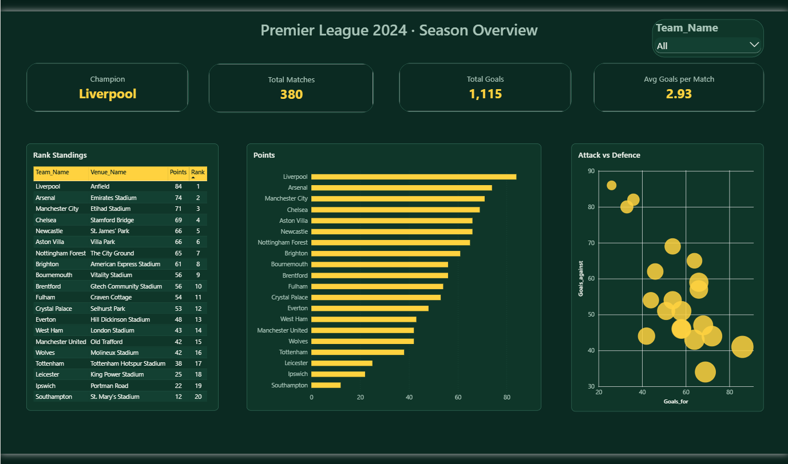

# 👋 Hi, I'm Thouseef

**Financial Clarity Partner · Finance · Law · Data · Tech**

## 🌟 About Me

Finance and tax professional with 13+ years across accounting, audit, tax compliance and financial reporting. I combine that background with Power BI dashboards, SQL Server and Python ETL projects, and explain numbers plainly to people who aren't finance specialists.

---

## 💼 Experience

- 🔹 **Freelance Financial Consultant** - Proacte Consulting and Advisory (2023 - present): accounting, tax compliance and financial reporting for SME clients.
- 🔹 **Volunteer Finance Advisor and Internal Auditor** - Ignite Foundation (2024 - present): bookkeeping, grant tracking and compliance support.
- 🔹 **Earlier roles:** Finance Advisor at Agua India · Associated Partner & Senior Consultant at Ravel Business Solutions · Finance & Tax Consultant at TAXR · Senior Accountant at Ideamine & Empressem Technologies · Articled Assistant at Paulson & Co.

---

## 🎓 Education & Learning

- **LLB (in progress)** - CUSAT School of Legal Studies
- **BCom** - St. Paul's College, Kalamassery
- **CA Intermediate coursework** - ICAI
- **McKinsey.org Forward Program**
- **Data analytics training** - Rows & Columns

---

## 📊 Featured Project

### Premier League Standings ETL

⚽ A training project using API-Football, Python and SQL Server, with staging tables, upsert procedures and data-quality checks, followed by a Power BI dashboard.

[🔗 View Project on GitHub](https://github.com/thousifva/EPL_Standings_ETL)

---

## 🧠 Tools & Skills

Power BI, DAX, Excel, Power Query, SQL Server, Python, pandas, Tableau and Jupyter. Accounting tools: QuickBooks, Zoho Books, Xero and Tally.

---

## 🎯 Interests

💰 Finance · ⚖️ Law · 📊 Data · 🤖 AI & Technology

---

## 📫 Connect

- 💼 [LinkedIn](https://www.linkedin.com/in/thousifva/)
- 🌐 [thouseef.com](https://thouseef.com)
- 📍 Kochi, Kerala
